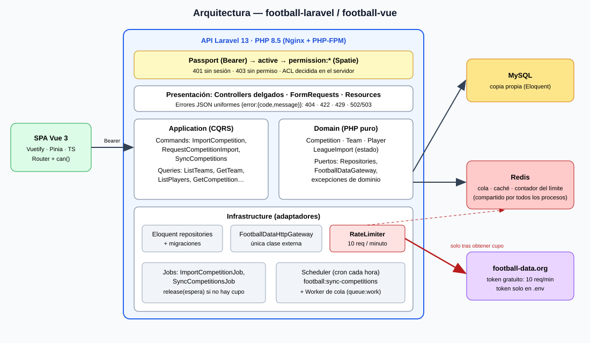
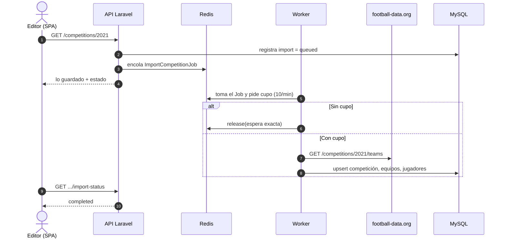
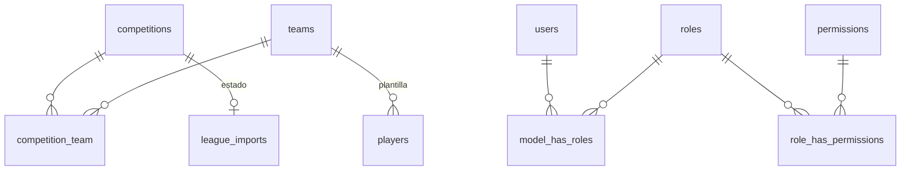

# football-laravel · API REST (Laravel 13 · PHP 8.5)

API que consulta [football-data.org](https://www.football-data.org), guarda una copia propia (Eloquent + MySQL) y controla **quién puede hacer qué** (Passport + roles y permisos). La SPA vive en el repositorio hermano **[football-vue](https://github.com/ZielGit/football-vue)**.

## Contenido

1. [Cómo ejecutarlo](#1-cómo-ejecutarlo)
2. [Usuarios de prueba](#2-usuarios-de-prueba)
3. [Endpoints](#3-endpoints)
4. [El límite de 10 peticiones por minuto](#4-el-límite-de-10-peticiones-por-minuto)
5. [Arquitectura y decisión argumentada](#5-arquitectura-y-decisión-argumentada)
6. [Diagramas](#6-diagramas)
7. [Pruebas y CI](#7-pruebas-y-ci)
8. [Opcionales realizados](#8-opcionales-realizados)
9. [Supuestos y pendientes](#9-supuestos-y-pendientes)

---

## 1. Cómo ejecutarlo

### Requisitos
- Docker y Docker Compose v2.
- Un token gratuito de football-data.org (https://www.football-data.org/client/register). **No lo subas al repositorio.**
- Los dos repositorios clonados en la **misma carpeta**:

```
mi-carpeta/
├── football-laravel/
└── football-vue/
```

### Con Docker (recomendado, un solo comando)

```bash
cd football-laravel
cp .env.docker .env # (tanto en el backend como frontend)
# Edita .env y pega tu token:  FOOTBALL_DATA_TOKEN=xxxxxxxx
docker compose up -d --build
```

En Linux, si tu usuario no es el 1000, usa `HOST_UID=$(id -u) HOST_GID=$(id -g) docker compose up -d --build` para que los archivos generados queden a tu nombre.

La primera vez, el servicio `app` instala dependencias, genera `APP_KEY`, crea las llaves de Passport, ejecuta migraciones y seeders (puede tardar unos minutos). Para ver el avance: `docker compose logs -f app`. Cuando termina:

| Servicio | URL |
|---|---|
| SPA (Vue) | http://localhost:8080 |
| API | http://localhost:8000/api |

Servicios del `compose.yml`: `app` (PHP-FPM 8.5), `nginx`, `mysql` 8.4, `redis`, `queue` (worker de Jobs), `scheduler` (cron de Laravel) y `frontend`.

Comandos útiles:
```bash
docker compose exec app php artisan football:sync-competitions --now   # forzar la lista de competiciones
docker compose exec app vendor/bin/phpunit                             # pruebas unitarias
docker compose logs -f queue                                           # ver los Jobs trabajar
docker compose down -v                                                 # apagar y borrar datos
```

### Sin Docker (opcional)
Requiere PHP 8.5 (extensiones `pdo_mysql`, `bcmath`, `mbstring`), Composer, MySQL y Redis locales.

```bash
cp .env.example .env     # ajusta DB_HOST=127.0.0.1, REDIS_HOST=127.0.0.1 y FOOTBALL_DATA_TOKEN
composer install
php artisan key:generate
php artisan vendor:publish --tag=passport-migrations
php artisan passport:keys
php artisan migrate --seed
php artisan serve                 # API en http://localhost:8000
php artisan queue:work redis      # en otra terminal
php artisan schedule:work         # en otra terminal (cron)
```

### Variables de entorno (`.env.example`)
| Variable | Para qué |
|---|---|
| `FOOTBALL_DATA_TOKEN` | Token de football-data.org (**solo aquí**, nunca en código) |
| `FOOTBALL_DATA_RATE_LIMIT` | Peticiones por minuto permitidas (10 en el plan gratuito) |
| `FOOTBALL_COMPETITIONS_TTL_MINUTES` / `FOOTBALL_IMPORT_TTL_MINUTES` | Cuándo se considera vieja la lista / una liga importada |
| `DB_*`, `REDIS_*` | Conexiones. `CACHE_STORE`, `QUEUE_CONNECTION` = `redis` |
| `PASSPORT_TOKEN_TTL_HOURS` | Vigencia del token de acceso |
| `CORS_ALLOWED_ORIGINS` | Orígenes de la SPA permitidos |

## 2. Usuarios de prueba

| Rol | Correo | Contraseña | Puede |
|---|---|---|---|
| Admin | `admin@football.test` | `Admin123!` | Todo, incluidos usuarios, roles y permisos |
| Editor | `editor@football.test` | `Editor123!` | Consultar **e importar ligas** |
| Viewer | `viewer@football.test` | `Viewer123!` | Solo consulta (no dispara importaciones) |

Permisos: `competitions.view`, `competitions.import`, `teams.view`, `players.view`, `users.manage`, `roles.manage`. Se aplican **en el servidor** con middleware (`permission:*`) y la SPA solo los usa para mostrar u ocultar opciones.

## 3. Endpoints

Todo exige `Authorization: Bearer <token>` salvo el login.

| Método y ruta | Permiso | Descripción |
|---|---|---|
| `POST /api/login` | público | Correo + contraseña → token de Passport |
| `POST /api/logout` | autenticado | Revoca el token actual |
| `GET /api/me` | autenticado | Perfil + `permissions` (lista) + `abilities` (`{action, subject}`, formato CASL) |
| `GET /api/competitions` | `competitions.view` | Competiciones guardadas |
| `GET /api/competitions/{competition_id}` | `competitions.view` | Detalle; **si el rol tiene `competitions.import`, encola la importación de equipos y jugadores** |
| `GET /api/competitions/{competition_id}/import-status` | `competitions.view` | Estado de la importación (extra, para el *polling* de la SPA) |
| `GET /api/team` · `GET /api/team/{team_id}` | `teams.view` | Equipos guardados (paginados, `search`, `competition_id`) y detalle con plantilla |
| `GET /api/players` · `GET /api/players/{player_id}` | `players.view` | Jugadores (paginados, `search`, `team_id`, `position`, `competition_id`); el detalle es un extra para el 404 de jugador |
| `GET/POST/PUT /api/users`, `PATCH /api/users/{id}/activate\|deactivate` | `users.manage` | Gestión de usuarios (crear, editar, asignar roles, desactivar) |
| `GET /api/roles`, `GET /api/permissions` | `users.manage` o `roles.manage` | Para asignar roles |
| `POST/PUT/DELETE /api/roles` | `roles.manage` | Gestión de roles y permisos |

**Formato de error único** (siempre JSON):
```json
{ "error": { "code": "TEAM_NOT_FOUND", "message": "Equipo con id 9 no existe…", "details": {} } }
```
| Caso | HTTP | `code` |
|---|---|---|
| Equipo / jugador / competición inexistente | 404 | `TEAM_NOT_FOUND`, `PLAYER_NOT_FOUND`, `COMPETITION_NOT_FOUND` |
| Datos inválidos | 422 | `VALIDATION_ERROR` (`details.fields`) |
| Sin sesión / credenciales | 401 | `UNAUTHENTICATED`, `INVALID_CREDENTIALS` |
| Sin permiso / cuenta desactivada | 403 | `FORBIDDEN`, `ACCOUNT_DISABLED` |
| Límite de peticiones (nuestra API o football-data) | 429 | `TOO_MANY_REQUESTS`, `EXTERNAL_RATE_LIMIT` (+ cabecera `Retry-After`) |
| football-data caído / sin token | 503 | `EXTERNAL_SERVICE_UNAVAILABLE` |

## 4. El límite de 10 peticiones por minuto

**Decisión:** las peticiones de los usuarios **nunca** llaman a football-data. Solo lo hacen los *Jobs* en segundo plano, y cada llamada saliente pasa por un limitador compartido.

1. **Lectura independiente de la fuente externa.** Todos los `GET` responden desde MySQL. Si football-data está caído o sin cupo, lo ya guardado se sigue sirviendo (requisito B5).
2. **Importación asíncrona (Job en cola).** `GET /competitions/{id}` devuelve lo guardado y deja un `ImportCompetitionJob` en Redis (con estado `queued → running → completed`). La SPA consulta `import-status` hasta que termine.
3. **Limitador compartido en Redis** (`FootballDataRateLimiter`): se consume un cupo *antes* de cada llamada saliente. Al estar en Redis, lo comparten el worker, el cron y cualquier proceso. Por defecto 10/minuto (`FOOTBALL_DATA_RATE_LIMIT`).
4. **Sin cupo no se pierde el trabajo:** el Job hace `release()` con la espera exacta que calcula el limitador, y el estado pasa a `waiting_rate_limit`. Si el *proveedor* responde 429, se respeta su cabecera.
5. **Una liga cuesta 1 petición.** `GET /competitions/{id}/teams` ya incluye las plantillas, así que importar una liga completa (equipos + jugadores) consume un solo cupo. Quedan 9 por minuto para el resto.
6. **Sin duplicados ni trabajo repetido:** los ids locales son los de football-data (`upsert`), el Job es único por liga (`ShouldBeUnique`) y no se vuelve a encolar si hay una importación activa o una reciente (`FOOTBALL_IMPORT_TTL_MINUTES`).
7. **Cron (cada hora):** `football:sync-competitions` refresca la lista de competiciones (1 petición). Una consulta a `GET /competitions` con la lista vieja también lo encola, protegido por un candado para no duplicar.

Alternativas descartadas: llamada síncrona en la petición (se cae al cuarto clic y acopla la latencia al proveedor), solo caché (no cubre la caída del proveedor ni el límite en escrituras), `sleep()` entre llamadas (bloquea workers FPM).

**Probar el límite:** pon `FOOTBALL_DATA_RATE_LIMIT=2` en `.env`, reinicia (`docker compose restart queue app`) e importa 3 ligas seguidas como Editor: la tercera queda en *“Esperando cupo de football-data”* y termina sola al siguiente minuto (se ve en `docker compose logs -f queue`).

## 5. Arquitectura y decisión argumentada

El proyecto tiene **dos contextos** y no se les aplica el mismo nivel de arquitectura:

| Contexto | Enfoque | Dónde |
|---|---|---|
| **Football** (núcleo del negocio) | Hexagonal + DDD ligero + CQRS | `app/Football/{Domain,Application,Infrastructure}` |
| **Identity** (usuarios/roles/permisos) | Capas simples de Laravel sobre Spatie | `app/Services/Identity`, `app/Http` |

**Alternativas comparadas**

| Opción | A favor | En contra | Veredicto |
|---|---|---|---|
| Capas simples de Laravel (controller → service → Eloquent) | Mínimo código, idiomática | La lógica queda atada a Eloquent y al cliente HTTP; probar la importación exige base de datos y mocks de HTTP | Suficiente para **Identity** |
| Clean Architecture completa | Capas muy claras | Casos de uso + presenters + DTO en cada borde: sobrediseño para 5 endpoints | Descartada |
| **Hexagonal (puertos y adaptadores)** | Aísla justo las dos fronteras que cambian o fallan: football-data y la persistencia; permite pruebas unitarias en memoria | Más archivos | **Elegida para Football** |
| Ninguna | Rapidez | El límite de peticiones y el proveedor externo se mezclarían con los controladores | Descartada |

**Por qué hexagonal y no Clean Architecture:** el problema difícil es proteger al sistema del proveedor externo (cupo, caídas, formato). Eso lo resuelve un **puerto** (`FootballDataGateway`) con un adaptador (`FootballDataHttpGateway`). Clean Architecture añade capas (presenters, input/output boundaries) que aquí no aportan valor.

**Por qué Identity no lleva hexagonal:** es un subdominio *genérico*; usar `spatie/laravel-permission` detrás de servicios delgados es más claro y mantenible que reinventarlo con puertos.

**DDD:** vocabulario del negocio (`Competition`, `Team`, `Player`, `LeagueImport`), entidades inmutables en PHP puro sin dependencias de Laravel, repositorios como puertos y excepciones de dominio (`TeamNotFound`, `ExternalRateLimitExceeded`…) que la capa HTTP traduce a códigos.

**CQRS ligero** (sin bus ni *event sourcing*): *commands* que escriben (`ImportCompetition`, `RequestCompetitionImport`, `SyncCompetitions`, `RequestCompetitionsRefresh`) separados de *queries* que solo leen (`ListTeams`, `GetTeam`, `ListPlayers`…). Aporta valor aquí porque lectura y escritura tienen requisitos opuestos: las lecturas deben ser rápidas e independientes del proveedor; las escrituras son lentas, asíncronas y limitadas.

**SOLID / Clean Code:** controladores delgados; una clase por caso de uso (SRP); dependencias a interfaces (DIP) enlazadas en un único *composition root* (`FootballServiceProvider`); el cliente de football-data aislado en una sola clase.

```
app/Football/
├── Domain/          # modelos, puertos (interfaces), excepciones — PHP puro
├── Application/     # Command/ y Query/ (casos de uso) + Port/ (colas, estado, transacciones)
└── Infrastructure/  # Eloquent, cliente HTTP + limitador, Jobs, comando de consola
```

## 6. Diagramas

Todos en `docs/` con su archivo editable.

### Arquitectura — `docs/arquitectura.svg` (editable: `docs/arquitectura.mmd`)


Muestra la SPA, el API con Passport + ACL, las capas hexagonales, MySQL, Redis (cola, caché y contador del límite), el worker/cron y football-data.org. Lo importante: **solo el adaptador pasa por el limitador** y solo los Jobs lo invocan.

### Flujo de importación — `docs/flujo-importacion.mmd`

Explica por qué la petición del usuario es inmediata y el límite se absorbe en segundo plano.

### Modelo de datos — `docs/modelo-datos.mmd`

Los ids de `competitions`, `teams` y `players` son los de football-data: así reimportar una liga no duplica registros. Versión completa con columnas en `docs/modelo-datos.mmd`.

## 7. Pruebas y CI

```bash
docker compose exec app vendor/bin/phpunit        # pruebas unitarias (sin base de datos)
docker compose exec app vendor/bin/pint --test    # estilo
docker compose exec app vendor/bin/phpstan analyse --memory-limit=1G
```
Las pruebas cubren: el limitador (`FootballDataRateLimiterTest`), el cliente HTTP con respuestas simuladas — 404, 429, 5xx, caída de conexión, token ausente (`FootballDataHttpGatewayTest`), la importación idempotente y sus estados (`ImportCompetitionHandlerTest`), cuándo se encola o no una importación/actualización, las consultas con sus 404 y el formato de errores de la API.

**CI (GitHub Actions)** — `.github/workflows/ci.yml`: Pint, PHPStan y PHPUnit en PHP 8.5. El build y el chequeo de tipos del frontend están en el workflow de `football-vue`.

## 8. Opcionales realizados

Vuetify · Pinia · Composition API + TypeScript · componentes reutilizables · Docker · DDD · hexagonal · CQRS · decisión de arquitectura argumentada · SOLID/Clean Code · pruebas unitarias · CI · colas (Jobs) y Cron · modelo de datos y diagramas.
No se usó CASL (permisos en JS puro; `/me` entrega además `abilities` por si se quiere adoptar después).

## 9. Supuestos y pendientes

**Supuestos**
- **Roles y permisos con `spatie/laravel-permission`**, guard `api` (Passport). Roles: Admin, Editor, Viewer.
- **Passport con *personal access tokens*** (login propio por correo y contraseña); el token vence a las 8 h por defecto.
- **El dorsal es opcional:** el plan gratuito de football-data normalmente no lo entrega en las plantillas; se guarda si viene y si no queda en blanco (`shirt_number` nullable).
- Las rutas son `/team` (singular) como pide el enunciado; paginadas con `meta`. Se agregó `GET /players/{id}` y `/competitions/{id}/import-status`.
- `GET /competitions/{id}` dispara la importación solo para quien tiene `competitions.import`; un Viewer ve lo ya guardado.
- Los jugadores que dejan una plantilla no se eliminan (solo se actualiza su equipo si aparecen en otro).
- Las migraciones de Passport se publican automáticamente en el primer arranque (`entrypoint.sh`); las de Spatie vienen incluidas en el repositorio.

**Pendiente / cómo lo haría**
- Pruebas de integración con base de datos y permisos por rol (hoy solo unitarias).
- Refresco programado de ligas ya importadas (hoy solo la lista de competiciones).
- Versión de PHPStan en nivel más estricto y *Pest* si el equipo lo prefiere.
